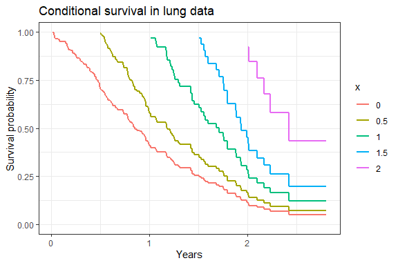

<!-- README.md is generated from README.Rmd. Please edit that file -->

# condsurv

The `condsurv` package contains a function for generating conditional
survival estimates with associated confidence intervals, and a function
for plotting conditional survival curves.

## Installation

Install the package using

``` r
pak::pak("zabore/condsurv")
```

## Estimate conditional survival

``` r
library(condsurv)
library(dplyr)
library(survival)
```

If $S(t)$ represents the survival function at time $t$, then conditional
survival is defined as

$$S(y|x) = \frac{S(x + y)}{S(x)}$$

where $y$ is the number of additional survival years of interest and $x$
is the number of years a subject has already survived.

The `conditional_surv_est` function will generate this estimate along
with 95% confidence intervals.

The `lung` dataset from the `survival` package will be used to
illustrate.

``` r
# Scale the time variable to be in years rather than days
lung2 <- 
  mutate(
    lung,
    os_yrs = time / 365.25
  )
```

First generate a single conditional survival estimate. This is the
conditional survival of surviving to 1 year conditioned on already
having survived 6 months ($0.5$ year). This returns a list, where
`cs_est` is the conditional survival estimate, `cs_lci` is the lower
bound of the 95% confidence interval and `cs_uci` is the upper bound of
the 95% confidence interval.

``` r
myfit <- survfit(Surv(os_yrs, status) ~ 1, data = lung2)

conditional_surv_est(
  basekm = myfit,
  t1 = 0.5, 
  t2 = 1
)
#> $cs_est
#> [1] 0.58
#> 
#> $cs_lci
#> [1] 0.49
#> 
#> $cs_uci
#> [1] 0.66
```

You can easily use `purrr::map_df` to get a table of estimates for
multiple timepoints. For example we could get the conditional survival
estimate of surviving to a variety of different time points given that
the subject has already survived for 6 months (0.5 years).

``` r
prob_times <- seq(1, 2.5, 0.5)

purrr::map_df(
  prob_times, 
  ~conditional_surv_est(
    basekm = myfit, 
    t1 = 0.5, 
    t2 = .x) 
  ) %>% 
  dplyr::mutate(years = prob_times) %>% 
  dplyr::select(years, everything()) %>% 
  knitr::kable()
```

| years | cs_est | cs_lci | cs_uci |
|------:|-------:|-------:|-------:|
|   1.0 |   0.58 |   0.49 |   0.66 |
|   1.5 |   0.36 |   0.27 |   0.45 |
|   2.0 |   0.16 |   0.10 |   0.25 |
|   2.5 |   0.07 |   0.02 |   0.15 |

### A note on confidence interval estimation

The confidence intervals are based on a variation of the log-log
transformation, also known as the “exponential” Greenwood formula, where
the conditional survival estimate is substituted in for the traditional
survival estimate in constructing the confidence interval.

If $\hat{S}(y|x)$ is the estimated conditional survival to $y$ given
having already survived to $x$, then

$$\hat{S}(y|x)^{exp(\pm1.96\sqrt{\hat{L}(y|x)})}$$

where

$$\hat{L}(y|x)=\frac{1}{\log(\hat{S}(y|x))^2}\sum_{j:x \leq \tau_j \leq y}\frac{d_j}{(r_j-d_j)r_j}$$

and

$\tau_j$ = distinct death time $j$

$d_j$ = number of failures at death time $j$

$r_j$ = number at risk at death time $j$

## Plot conditional survival curves

``` r
library(ggplot2)
```

To plot the conditional survival curves at baseline, and for those who
have survived 6 months, 1 year, 1.5 years, and 2 years, we use the
`gg_conditional_surv` function.

The `lung` dataset from the `survival` package will be used to
illustrate.

``` r
# Scale the time variable to be in years rather than days
lung2 <- 
  mutate(
    lung,
    os_yrs = time / 365.25
  )
```

``` r
myfit <- survfit(Surv(os_yrs, status) ~ 1, data = lung2)

cond_times <- seq(0, 2, 0.5)

gg_conditional_surv(
  basekm = myfit, 
  at = cond_times,
  main = "Conditional survival in lung data"
  ) 
```



## Documentation

This package is documented using
[pkgdown](https://pkgdown.r-lib.org/articles/pkgdown.html), and the
resulting website is available at <http://www.emilyzabor.com/condsurv/>,
where detailed Tutorials can be found covering all of the package
functionality.

See <http://www.emilyzabor.com/condsurv/reference/> for detailed
function documentation.
